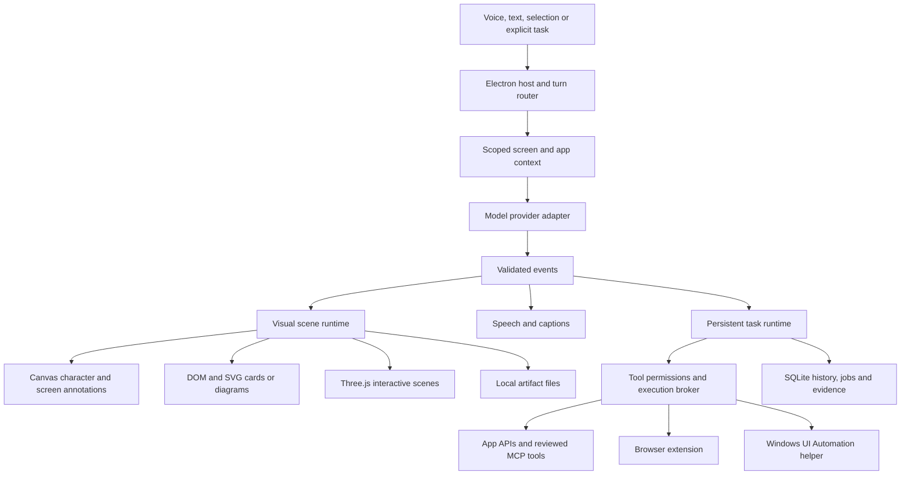

# HeyGuy: full desktop companion plan

Date: 2026-11-04. Status: architecture recommendation and implementation plan; not an implemented release.

**Goal:** Build an open-source, Windows-first companion that understands the user's screen, speaks, teaches through live 2D/3D visuals, drafts useful work, and completes explicitly delegated desktop and browser tasks.

**Architecture:** Keep Electron and TypeScript as the desktop shell and orchestration layer. Use Canvas 2D for the character and screen marks, DOM/SVG for explanatory cards and diagrams, and Three.js for interactive 3D. A separate task runtime reaches browser extensions, application APIs and a narrow Windows native helper through validated, permission-scoped tools.

**Tech stack:** Electron, TypeScript, existing esbuild/DOM code, Canvas 2D, SVG, Three.js, runtime schemas, SQLite, a Chrome extension with native messaging, and a C# Windows helper using UI Automation and Win32 input where needed. Provider adapters support cloud language/vision models, speech services and optional documented subscription-backed inference.

**Reference specification:** [Evidence and feature matrix](REFERENCE-AND-GAPS.md), IDs F01–F27. Freeze the reference version in M0. New HeyClicky releases become tracked changes, not an endlessly moving definition of done.

**Global constraints:** Preserve the existing project. Plan for full functional scope while delivering in testable stages. Windows is the first platform, the user owns the data and credentials, capture is visible and scoped, generated scenes cannot acquire desktop authority, and completed actions require observable evidence. A milestone is not whole-product completion.

## 1. Selected approach

Choose **Electron plus a hybrid visual engine and explicit task runtime**. Your existing project already contains useful parts of that architecture. There is no need to throw it away or train a foundation model.

| Approach | Benefits for this project | Main cost | Decision |
|---|---|---|---|
| Extend Electron/TypeScript, add 3D and native adapters | Reuses current companion, one language for most UI/runtime logic, browser-native interactive visuals | Chromium memory footprint, display/focus edge cases, native helper still required | Selected |
| Rebuild Windows shell in C#/WinUI with an embedded web scene surface | Direct Windows integration and potentially better control of native windows | Rewrite of working code, two UI systems, a separate Mac shell later | Reserve if measured Electron limitations block acceptance |
| Build around Godot or a custom/native graphics engine | Strong game-style scene composition | Browser/account integrations, accessibility, background workflows and desktop UX remain substantial separate work | Not justified for the current target |

Canvas alone is insufficient for the requested 3D and document workspace. Electron itself does not supply a dependable desktop automation agent. Those are modules to build, not reasons to restart the project.

Use PixiJS only if a measured 2D workload outgrows Canvas. Live2D or VRM may later enrich the character, but neither solves desktop control or generated educational scenes. HyperFrames belongs in an optional video-export or demo pipeline, not the live companion's animation clock. Autoresearch training is unnecessary for this architecture.

The target is behavioral parity: the same useful classes of tasks, interactions and outcomes. The current private HeyClicky implementation is not available in its public repository, so we cannot promise identical internals or claim complete parity without comparative testing. [Reference evidence](REFERENCE-AND-GAPS.md)

## 2. The product should feel like this

1. **Explain:** Point at an error, hold the shortcut, ask what went wrong. HeyGuy captures the selected context, answers aloud, and anchors a mark to the actual error. A follow-up uses the same conversation.
2. **Show:** Ask how a transformer works. HeyGuy creates a legible diagram with animated data flow. Ask to expand attention; it updates the same scene and preserves useful context.
3. **Explore in 3D:** Ask for an engine. A labelled model appears in a movable scene panel. Rotate it, select a piston, and ask why it moves. HeyGuy knows which part was selected and highlights it while answering.
4. **Draft:** Ask for an email based on a selected document. HeyGuy names the destination account, creates a real draft, and opens the draft result. Sending is a distinct authorized action.
5. **Do:** Delegate a task in an app. HeyGuy shows what it will do, obtains the necessary scoped control grant, executes steps, observes the result and yields immediately to interruption.
6. **Continue:** A longer research or file task runs in its own job card. You can ask another question, inspect progress, change requirements, stop it or reopen the result tomorrow.

The visual system is a core product capability. Put it early in the sequence. A chat bubble with decorative circles does not satisfy scenes, diagrams or 3D creation.

## 3. Runtime boundaries

### Host and windows

Keep `src/main/main.ts` as the composition root, gradually extracting turn coordination, display management and IPC into modules. Use a non-focusing click-through overlay for the character and annotations, a small interactive command surface, and an expandable workspace for chats, settings, jobs and files. Interactive scene panels must have explicit hit regions so dragging a model does not block the whole desktop.

Start with the existing plain DOM interface; do not make a framework migration a prerequisite. The larger workspace can adopt a component framework later if its complexity warrants it, without rewriting the renderer or task protocol.

Each capture has `captureId`, time, display ID, physical-pixel dimensions, desktop bounds, scale factor, crop rectangle and owning `turnId`. Persist the geometry contract with a reference image in tests. Convert model coordinates through that exact transform. If the display disappears, focus changes or the underlying window moves, invalidate or re-ground anchored annotations.

Electron supplies the relevant [window interaction APIs](https://www.electronjs.org/docs/latest/tutorial/custom-window-interactions). Multi-monitor scaling, fullscreen applications, focus restoration and GPU compatibility still need actual Windows acceptance.

### Turn and event contracts

Add `src/shared/protocol.ts` and runtime validators in `src/shared/schemas.ts`. Provider output never directly invokes IPC, evaluates JavaScript or controls input. Migrate the current tag protocol through a compatibility adapter, then use typed events/tool calls.

Every event carries protocol version, `turnId` or `jobId`, sequence number and a validated payload. Required families:

- Conversation: text delta, final text, transcript revision, state, error and cancellation.
- Visuals: annotation, scene create, scene patch, scene close, artifact reference and selection.
- Speech: utterance ID, queued text/audio, playback start/end and interruption.
- Tasks: proposal, permission request, tool invocation, tool result, progress, awaiting input and verified completion.

Reject invalid schemas, unknown operations, out-of-range coordinates, excessive payloads and stale turn output. Partial scene updates must be transactional: keep the last valid scene until the next patch passes validation. A disconnected provider leaves readable partial text and a clear incomplete state, not a fabricated success.

### Conversation and task engines

Use one user-facing identity with separate execution paths. A short explanation should not pay the latency or complexity of launching a general task. A task uses an explicit state machine:

`queued → planning → running → awaiting-input / awaiting-permission → running → completed / failed / cancelled`

Store durable state and append-only events locally. A process restart resumes observation and reconciliation, not blind replay of the last action. Make cancellation propagate to model calls, audio, scene generation, browser work and native input.

Independent API or research jobs may run concurrently within a cap. **Only one job may own interactive desktop input at a time.** Browser jobs own their tabs and must not compete to navigate the same page. A tool registry declares schemas, permissions, account scope, retry rules and evidence requirements. Use SDKs where they help; an AutoGPT-style framework is not a required architectural dependency.

## 4. Drawing and 3D: the core visual engine

### Layer A: grounded screen marks

Keep the current point, circle, box, underline and arrow primitives. Add freehand user input, selected regions and stable target identities. Marks refer to an observation version. A stale mark disappears or requests re-grounding instead of confidently pointing at a moved button.

For walkthroughs, observe the expected outcome after the user clicks. Merely detecting any click inside a rectangle is insufficient: a menu may fail to open or a button may be disabled. Explicit teaching sessions may capture additional frames at transitions under a visible observation grant; ordinary questions remain one-shot by default.

### Layer B: explanatory scenes

Build a declarative `SceneSpec2D`: stable node IDs, text, paths, groups, connectors, images, charts, layout constraints and a limited set of animations. Render labels/cards in accessible DOM/SVG; retain Canvas for paint-like animation. Include pointer/keyboard selection, move, resize, zoom, replay and save.

The model proposes a scene; our engine validates and lays it out. A layout pass detects overflow, overlapping labels, off-screen cards and illegible text. Follow-ups patch named objects instead of replacing the whole scene. Images carry source/attribution and an asset ID; the renderer does not fetch arbitrary URLs supplied by model output.

Start with a useful primitive grammar, not only three canned demos. Acceptance includes unseen combinations and follow-up edits. Richer generated mini-apps may come later in a separately isolated artifact surface with no privileged preload, no ambient filesystem access, no default network and strict resource limits. Do not run model-generated scripts inside the main process or trusted overlay.

### Layer C: semantic 3D scenes

Use Three.js for camera, lighting, geometry and rendering. A `SceneSpec3D` describes parts with stable IDs, transforms, materials, labels, geometry recipes, constraints and animation tracks. Implement vetted constructors for boxes, spheres, cylinders, tubes, extrusion and grouped assemblies. Complex shapes may come from licensed curated glTF assets or a later generation service; record their provenance.

The model must supply semantic metadata: part name, explanation, relationship to other parts and any uncertainty. [Raycaster](https://threejs.org/docs/pages/Raycaster.html) identifies the selected mesh; map it to its part ID and send that context into the next turn. [OrbitControls](https://threejs.org/docs/pages/OrbitControls.html) provides rotate/zoom/pan interaction. Preserve the camera and selection when applying a patch.

Support exploded view, highlight/isolate, simple mechanism animation, part lists, captions and a 2D fallback when GPU rendering fails. Use [GLTFExporter](https://threejs.org/docs/pages/GLTFExporter.html) for an optional export path, with round-trip testing. Saving an interactive explanation and exporting a production CAD model are different acceptance targets.

**3D generation has levels:** a useful schematic, a detailed reusable mesh, and an engineering/scientifically accurate model. Build schematic interaction first; keep detailed asset/generation work as the next capability within M4. Accurate CAD, simulation or complex molecular claims require appropriate data and domain validation. A valid JSON schema and a rotating object do not prove the explanation is correct.

If the user asks for an object outside the available geometry/asset vocabulary, say so or use an approved generation job. Do not silently return a generic cube and claim completion. Arbitrary Blender/Python generation, if added, must run inside a bounded sandbox or VM with a constrained output contract; spawning an unrestricted Python process is not isolation.

### Speech and graphics together

Make a response a sequence of semantic segments: spoken sentence, visual focus and optional scene change. Advance highlights on actual playback boundaries where supported. If a provider lacks timing alignment, use sentence-level synchronization and label its limits. User interruption stops queued speech and pending visual narration together. Reduced-motion mode preserves meaning without flying or pulsing effects.

## 5. Computer control and integrations

Choose the most reliable route available for each task:

1. **Supported app API or reviewed connector** for structured data, drafts, calendars and files.
2. **Browser extension** for the user's actual browser session and page semantics.
3. **Windows UI Automation** for native applications exposing accessibility elements.
4. **Screenshot-grounded pointer/keyboard actions** when semantic routes cannot perform the task.

This is an engineering preference, not a promise that every app exposes the first three routes. [UI Automation](https://learn.microsoft.com/en-us/windows/win32/winauto/entry-uiauto-win32) supplies programmatic access to many desktop elements. [SendInput](https://learn.microsoft.com/en-us/windows/win32/api/winuser/nf-winuser-sendinput) supplies input injection but is constrained by Windows integrity levels. Do not elevate the whole companion or promise control of secure desktops to hide that limitation.

Implement a small C# helper under `native/windows/`. Electron communicates over a private parent-child channel with validated requests. Keep the helper's initial vocabulary narrow: inspect active window, query elements, invoke a supported control pattern, type, click, drag, scroll, detect user takeover and stop. Validate foreground target, process/window identity and freshness immediately before input. Tag synthetic input so our own events are not confused with user takeover.

For browser sessions, use an extension under `extensions/chrome/` and a registered [native messaging host](https://developer.chrome.com/docs/extensions/develop/concepts/native-messaging). The host and extension are separate protocol endpoints; do not treat the existing Electron IPC as Chrome native messaging. Limit extension origins, requested site permissions and tab ownership. Handle inaccessible browser pages, cross-origin frames and closed shadow roots explicitly. A new Playwright profile is useful for tests and isolated tasks, but does not automatically contain the user's signed-in sessions.

Start connected apps with Gmail because it produces a concrete result. Implement account selection, OAuth scopes, create/update/read draft and a separately authorized send operation. The [Gmail API distinguishes draft creation from sending](https://developers.google.com/workspace/gmail/api/guides/drafts). Reconcile an ambiguous timeout before retrying a mutation; an idempotency key in our database alone does not make a provider operation idempotent. Add calendar and file services afterward, then custom MCP with declared tool permissions.

Control modes:

| Mode | Scope | User experience |
|---|---|---|
| Explain | Explicit screen context, no desktop mutation | Indicator shows what is shared; answer and visuals |
| Guide | Observation during a bounded walkthrough | User acts; HeyGuy verifies each outcome |
| Act | A named task, selected apps/accounts and a control lease | Visible task state, stop control, immediate user takeover |
| Routine | Previously configured schedule and allowed tools | Runs only within the saved scope; reports meaningful results or failures |

Reuse an existing grant for routine steps within its scope. Request new input when the task expands scope or reaches an unapproved consequential action. Do not interrupt every harmless click with a new question. Show a reviewable recipient/body/attachment or file change before a commit that needs approval.

Treat text on webpages, documents and screenshots as task data, not as authority to expand permissions. Tool execution must pass a host-side policy decision independent of the model's prose. Keep credentials, file writes and input injection outside artifact renderers; [Electron's security guidance](https://www.electronjs.org/docs/latest/tutorial/security) is a baseline, not the entire design.

## 6. LLMs, subscriptions and operating cost

**Use existing models. Build the product's orchestration, perception, rendering, memory and tools.** Owning those systems creates the product; training an LLM is not a prerequisite. No dedicated CUDA GPU is required when inference runs through a cloud provider. Local models remain an option after measuring the actual machine, model license, memory use, latency and task quality.

### Two distinct uses of your subscriptions

- **Development:** use Codex and Claude Code to write, inspect and test this repository within their normal allowances.
- **Running HeyGuy:** every provider adapter needs a supported credential/entitlement route. Some current subscription routes can help, but they are not interchangeable with arbitrary API calls.

Current options verified from official documentation:

| Route | Practical use | Decision |
|---|---|---|
| Bring-your-own Anthropic/Gemini/OpenAI API key | Direct runtime integration, provider billing and quotas | Stable baseline interface; use one working provider first |
| Sign in with ChatGPT for eligible open-source/local apps | User grants plan access to eligible Responses requests | Prioritize a small eligibility/inference spike because you intend to open-source HeyGuy |
| Codex app-server using the documented plan-access route | Local job/session integration with Codex | Optional job backend, not required for every voice turn |
| User-authenticated, unmodified Claude Code | Local coding/task backend under the provider's conditions | Optional adapter; do not implement our own Claude subscription-token proxy |
| Local speech/model runtime | Offline/privacy mode or reduced variable costs | Evaluate later on target hardware; quality and RAM/VRAM remain constraints |

[OpenAI's plan-access overview](https://developers.openai.com/siwc/token-sharing-open-source) documents open-source/local application support and a separate interest route for paid/remote hosting. The [preview limits](https://developers.openai.com/siwc/token-sharing-open-source/preview-limitations) exclude audio/video input, transcription, image-generation tools, native computer use and hosted connectors on this route. Eligible text/image inference can still propose our validated local tools. Voice needs its own service or local engine. Account eligibility, limits and successful inference must be checked; an installed subscription alone does not prove access.

For OpenAI, support either direct eligible Responses inference or the documented [app-server adapter](https://developers.openai.com/siwc/token-sharing-open-source/codex-app-server); do not maintain both in the first spike. Prefer direct inference for the low-latency companion and evaluate app-server for jobs. Store our own authorized OAuth credentials, handle refresh/revocation and never scrape another app's session files. A catalog entry is not an entitlement test.

Anthropic's [current guidance](https://code.claude.com/docs/en/legal-and-compliance) distinguishes a user signing into its unmodified binary from a third party offering its own Claude login or routing subscriber credentials. Its [plan guidance](https://support.claude.com/en/articles/15036540-use-the-claude-agent-sdk-with-your-claude-plan) also describes continued SDK/CLI subscription usage and API credits for eligible plans. We have not checked your exact plan or credits. Keep the Claude API adapter and any user-authenticated CLI adapter distinct; validate the selected distribution against the current terms before release.

### Model selection

Do not hard-code a “best model” based on a demo or use the existing default strings as proof. In M1, select available candidates for these roles:

- Fast conversational vision and screen grounding.
- Strong scene planning, structured output and tool decisions.
- Speech recognition, including English/Hindi code switching.
- Speech output with intelligibility, streaming and interruption support.

Begin with the existing Claude/Gemini transports for the baseline, then add eligible OpenAI access without forcing a rewrite. Compare live candidates on the same evaluation set, context, tool limits and hardware/network conditions. Route easy explanations to the fastest model that passes quality gates; use stronger reasoning for complex scenes/jobs. Escalation and provider fallback must be visible and respect the user's data-sharing choice.

A chained speech-to-text → model → speech pipeline offers clear control and debugging. Evaluate a realtime voice adapter after that works. [Gemini Live tools](https://ai.google.dev/gemini-api/docs/live-api/tools) still require client-side handling, and capabilities vary by model. No voice model gets an unvalidated path to desktop input.

### Cost controls before long jobs

Record tokens, image inputs, audio duration, tool usage, provider/model, time and job ID. Load dated provider prices when configuring a paid adapter; no unverified per-month price estimate is presented here.

`session cost = text input + cached input + text output + image processing + speech input + speech output + paid tools + optional compute`

For token-priced components: `tokens / 1,000,000 × applicable rate`. Provider-specific image/audio accounting may differ. Sum actual billable units and reconcile against provider usage. Subscription allowance usage is a different meter; do not label it $0 unlimited API capacity.

Set configurable per-turn, per-job, daily and monthly ceilings, with conservative reservation before execution. Bound context, steps, output, tool payloads and retries; stop when a ceiling is reached. Where a plan route rejects output-limit parameters, enforce cancellation and budget boundaries on our side and disclose that usage can accrue before cancellation is processed. No automatic paid-provider fallback without the user's selection.

## 7. Local memory, artifacts and routines

Use SQLite for sessions, messages, named assistants, jobs, events, tool results, approvals, connectors, memories, artifacts, routines and usage. Store files in a separate application-managed directory with checksums and database references. Use migrations and recovery tests. Keep secrets in OS-backed encrypted storage; SQLite is not inherently encrypted.

Separate short-term visual context from durable memory. Screenshots stay transient by default. User-controlled memory stores useful summaries/preferences with provenance, timestamp, scope, confidence and delete/edit controls. A “remember this screenshot” feature needs an explicit retention choice. Explain separately what HeyGuy stores and what the selected provider may retain.

Start retrieval with conversation summaries and SQLite text search. Add embeddings only if retrieval tests justify them. Prevent one named assistant/account from accidentally inheriting another's private context. Attachments and imported scenes need size/type limits, safe previewing and path confinement.

Routines store the user's timezone, next scheduled run, task scope, budget and missed-run policy. A local-only routine cannot run while the PC is off: show deferred or skipped status. Prevent duplicate runs after waking or restarting. Cloud scheduling is a later hosting option with a separately authorized data/control path.

## 8. Delivery milestones and exact work areas

Effort ranges are planning estimates for focused engineering with AI assistance, not calendar promises. End-to-end Windows acceptance is likely a multi-month effort. Estimates exclude provider approval delays and later Mac parity. Work may overlap only where contracts and file ownership are clear.

| Milestone | Work and likely files | Required acceptance | Estimate |
|---|---|---|---|
| M0: Freeze the baseline and reference | Create `docs/BASELINE.md`, `docs/REFERENCE-ACCEPTANCE.md`, `docs/DECISIONS.md`; inspect package/lock provenance; initialize version control when implementation starts | Record app baseline and reference walkthrough with product versions, OS, exact tasks and observed results; distinguish vendor claims from tests | 2–4 days |
| M1: Reliable companion and provider access | Modify `src/main/main.ts`, `capture.ts`, `settings.ts`, `ai/*`; add `src/main/turns.ts`, `displays.ts`, `src/shared/protocol.ts`, `schemas.ts`; extend relevant `test/*` | Real screen-answer-draw loop, correct monitor, cancellation, secure credential behavior; evaluate optional plan-backed access; no demo substituted for live success | 1–2 weeks |
| M2: Conversation, voice and home | Add `src/main/conversations/*`, `src/main/audio/*`, initial `src/main/storage/*`, `src/renderer/home/*`; evolve `voice.ts`, `tts.ts`, `bubble.ts`; update build entries | Streaming transcript/reply, speech interruption, captions, input switching, history, reconnect, keyboard access and compact/expanded home | 1–2 weeks |
| M3: General 2D explanations | Add `src/shared/scene2d.ts`, `src/main/visuals/*`, `src/renderer/scenes2d/*`; evolve annotations; add scene/parser/layout tests | Unseen diagram requests render legibly, remain editable, synchronize with narration and survive follow-up changes; spatial user input works | 2–3 weeks |
| M4: Interactive 3D | Add `src/shared/scene3d.ts`, `src/renderer/scenes3d/*`, `src/main/artifacts/*`; add scene/selection/export tests | Generated semantic scenes, rotate/zoom/select part, question on selected part, mechanism animation, fallback and save/reopen; complex-asset limitations surfaced | 2–4 weeks |
| M5: Jobs, browser and real drafts | Add `src/main/jobs/*`, `tools/*`, `connectors/gmail/*`, `storage/*`, `extensions/chrome/*`, `native/browser-host/*`, workspace job/file views | Persistent job, actual Gmail draft, task-owned browser tabs, follow-up steering, account separation, retry reconciliation and result evidence | 2–4 weeks |
| M6: Windows drive and teaching | Add `native/windows/*`, `src/main/control/*`, `walkthroughs/*`; extend geometry and action tests | Controlled native-app workflows, semantic and pointer routes, stale-state detection, immediate takeover and verified walkthrough transitions | 2–4 weeks |
| M7: Persistent assistants, connectors and routines | Add `src/main/memory/*`, `scheduler/*`, further `connectors/*`, assistant/history views | Cross-day continuity, memory deletion, multi-account use, attachment preview, scheduling across sleep/restart and quiet notifications | 1–3 weeks |
| M8: Public Windows release | Add release configuration, `docs/TEST-REPORT.md`, `THIRD_PARTY_NOTICES.md`, license file, installer/update verification and support diagnostics | Clean-machine install/uninstall, signed release path, update recovery, accessibility/resource checks and published tested capability matrix | 1–3 weeks |

Proposed new paths are implementation targets, not existing files. Add build entries and IPC/preload surfaces as their milestones require them. Keep all milestones visible in the feature matrix; postponement changes order, not the final functional target.

Dependencies: M1 establishes turn/context contracts for every later milestone. M2 introduces the shared storage and conversation foundation. M3 establishes scene validation and lifecycle before M4 adds 3D; M4 introduces artifact storage reused by M5. M5 establishes task permissions, durable jobs and tool evidence before M6 can drive the desktop or M7 can schedule actions. M8 starts release engineering early but accepts the integrated product only after the preceding supported capabilities pass. A failed platform or provider spike changes the implementation decision explicitly in `docs/DECISIONS.md`; it does not silently delete its feature.

### First implementation work package

Each item is one reviewable change with its own evidence:

1. **Record baseline:** inspect scripts and dependency provenance, install locked dependencies in the agreed checkout, run `npm run check`, run the demo and inspect the existing overlay. Record failures without silently upgrading the stack. Files: `docs/BASELINE.md` and relevant setup documentation.
2. **Correct secret persistence:** add tests for unavailable encryption and migration, then change `src/main/settings.ts`. Verify session-only behavior, old-record handling and no raw secret logging.
3. **Correct capture identity:** change `src/main/capture.ts` and introduce display/crop metadata. Test missing display, negative origins and mixed scaling. No fallback capture from a different screen.
4. **Own asynchronous turns:** add turn IDs and cancellation rules in `src/main/turns.ts`, `src/shared/protocol.ts` and overlay handling. Test request A finishing after request B begins; A cannot overwrite B's text, marks, state or display lease.
5. **Verify a real provider:** validate available model/account configuration, make one user-triggered image request and record usage plus latency without storing private screen contents. Probe ChatGPT-plan eligibility separately from API fallback; record actual access result.
6. **Prove the visual contract:** one real explanation produces a validated scene/card and annotation through the new protocol; malformed output leaves the last valid state intact. This sets up M3 without prematurely building the entire engine.

Completion of this package is a reliaAaable foundation with demonstrated provider access, not a finished HeyClicky replacement.

## 9. Acceptance and evaluation

All numeric thresholds below are **proposed targets**, not measured results. Establish a Windows test machine profile in M0: OS, CPU, RAM, GPU, monitor arrangement, DPI, microphone, audio device and network. Tune thresholds explicitly from measured evidence rather than quietly lowering them.

Create a 60-case functional suite:

| Group | Cases | What a pass requires |
|---|---:|---|
| Screen understanding and pointing | 12 | Correct target and explanation across selected apps, crops and mixed-DPI displays; no wrong-screen capture |
| 2D generation and revision | 12 | Legible, meaningful layouts, working interaction and correct follow-up edit on unseen prompts |
| 3D generation and selection | 10 | Named parts, sensible geometry/relationships, working picking and relevant selected-part explanation |
| Browser/native workflows | 12 | Actual final state matches task, interruption works, retries do not duplicate mutations |
| Voice and dictation | 8 | Intelligible transcript/speech, English/Hindi/code switching, background noise and interruption handling |
| Persistence, memory and routines | 6 | Correct restart, deletion, account isolation, scheduling and artifact recovery |

Use private/test accounts and synthetic fixtures for repeatable automation. For live services, save redacted result identifiers and timestamps, not private screenshots or credentials. Review scientific explanations with authoritative domain references; visual attractiveness alone is not correctness. Track pass rates separately by category, model and platform. A single aggregate score must not hide a failed control boundary.

Additional release gates are mandatory regardless of the functional score:

- No desktop input or external commit outside the current task's granted scope in adversarial tests.
- User takeover and explicit stop prevent further input; target p95 below 200 ms on the reference machine, verified at the helper input boundary.
- Target p95 first useful output within 3 seconds after input finishes on the reference network for short questions; report provider time separately from local overhead.
- Target active 2D frame pacing near 60 FPS and basic 3D above 30 FPS on the reference hardware; measure rather than infer from source.
- Target idle CPU below 2% of total machine capacity over a five-minute sample with no active task. Report RAM/GPU use and agree budgets from baseline.
- No persistent increase in handles, audio tracks or scene GPU resources after repeated open/close/cancel cycles; include recovery after device changes, sleep, network loss and renderer/helper crashes.
- Test hotkey collisions, 100/125/150/200% scaling, two monitors with negative origins, monitor disconnect and the intended Windows versions. Do not claim configurations not actually exercised.
- Secrets unavailable means session-only or explicit failure, never silent plaintext persistence. Generated artifact content cannot reach privileged tool IPC.
- Gmail timeout/retry and restart tests never silently send or create duplicate results. An uncertain remote outcome is presented as uncertain until reconciled.
- Store exact expected/actual outcomes for each accepted reference task. Paid, unavailable or unsupported behavior remains marked pending, not passed.

First release acceptance should require every declared supported critical workflow to pass, with the noncritical capability matrix and known limitations published. “One-to-one parity” additionally requires matching the frozen reference matrix, including the agreed connector/language/platform coverage. No single-demo completion claim.

## 10. Codex and Claude working agreement

Use both assistants as implementers and reviewers. Neither should own all design and validation of the same feature without independent review. A practical split is one coherent feature slice at a time, followed by review from the other; alternate ownership rather than assuming either model has fixed strengths.

At implementation kickoff, write shared repository instructions in `AGENTS.md` and a short `CLAUDE.md` pointer to the same contract. Keep `docs/DECISIONS.md`, `docs/BUILD-STATE.md` and `docs/TEST-REPORT.md` current. Each task names its milestone, feature IDs, file ownership, interface changes and proof of completion. One writer per file/branch at a time; merge only after review and targeted checks.

Handoff prompt:

> Read docs/FULL-PRODUCT-PLAN.md and docs/REFERENCE-AND-GAPS.md. Preserve the full target and existing source. Work only on the assigned milestone slice. Inspect current instructions and changes first. Implement complete behavior with relevant tests, run the checks, and record observed results. Distinguish fixtures, live provider calls, UI checks and packaged-app acceptance. Do not replace missing functionality with a scripted demo or report a later milestone as finished. Leave a concrete handoff listing changed interfaces, evidence and remaining work.

No new general-purpose skill is needed to begin. The requested installed engineering, Superpowers, Unlazy, Impeccable and research workflows cover the planning task. Skill Creator can later encode a demonstrated project-specific workflow; creating skills now would not supply missing product behavior.

## 11. Decisions that remain open without blocking the architecture

- Actual supported runtime route for your accounts: API keys, eligible ChatGPT-plan access, a user-owned CLI backend or a combination.
- Monthly spend ceiling and exact target hardware; capture in M0/M1 before paid evaluation and performance commitments.
- First concrete app workflows beyond Gmail/browser/Windows text editing; select them from the frozen reference walkthrough and your own daily use.
- Which 3D subjects need schematic explanations versus detailed meshes or domain-accurate models; retain all requests but grade these separately.
- Mac support schedule and the final breadth of connectors/languages before any cross-platform parity claim.
- Hosted service, billing and cloud routines only if distribution expands beyond the personal/local open-source product.

The selected foundation can support the intended product. The difficult work is reliable grounding, scene quality, speech timing, state recovery and verified actions. More compute may improve a model response; it does not replace those systems.
